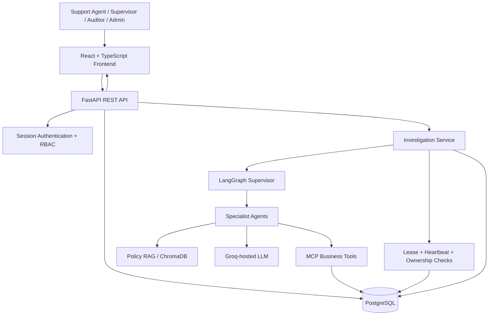
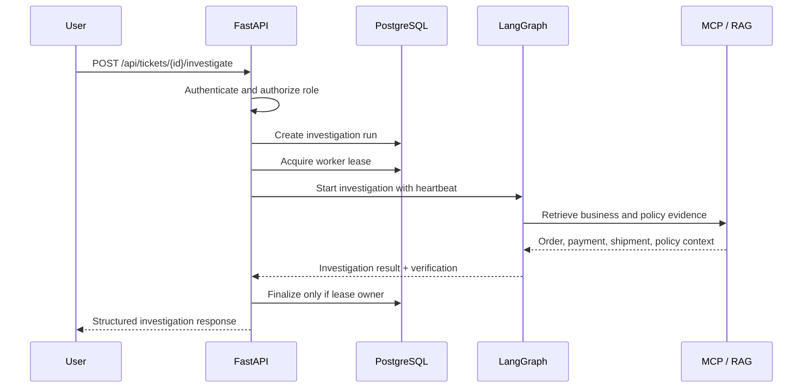

<div align="center">

# ResolveOps AI

### Enterprise-Style Multi-Agent Customer Support Investigation Platform

**Investigate support tickets with coordinated AI agents, grounded business tools, policy retrieval, and auditable operations.**

[](https://www.python.org/)
[](https://fastapi.tiangolo.com/)
[](https://langchain-ai.github.io/langgraph/)
[](https://www.postgresql.org/)
[](https://react.dev/)
[](https://www.docker.com/)

[Overview](#overview) · [Features](#features) · [Architecture](#architecture) · [Getting Started](#getting-started) · [API](#api-overview) · [Security](#security-and-access-control) · [Roadmap](#roadmap)

**Repository:** https://github.com/Gupta-G-0406/resolveops-ai

</div>

> **Project status:** Active development / portfolio demonstration. AI investigation, authentication, authorization, investigation persistence, and dashboard functionality have been implemented. Human-in-the-loop refund approvals and production deployment are **planned**, not yet complete. Demo business records and policy material should not be mistaken for a live payment or customer support system.

## Overview

ResolveOps AI is a full-stack, enterprise-style AI customer support operations application. Instead of returning an unsupported chatbot answer, it investigates a support ticket using an orchestrated multi-agent workflow, retrieves order/payment/shipment data through Model Context Protocol (MCP) tools, looks up relevant policy context through retrieval-augmented generation (RAG), verifies available evidence, and presents a structured investigation report.

The platform also provides a persistent operational layer: support tickets, investigation runs, history and statistics, authentication, role-based access control (RBAC), audit events, and mechanisms for protecting long-running investigation ownership.

### What problem does it solve?

Customer support investigations often require staff to manually cross-reference orders, payment records, shipment updates, and policies. ResolveOps AI demonstrates how an agentic workflow can bring that information together in a traceable investigation while keeping access to sensitive operations controlled by the application backend.

## Features

### Implemented

- **Multi-agent investigation:** LangGraph-based supervisor orchestration coordinates specialist investigation tasks.
- **Business-tool integration:** MCP tools retrieve order, payment, and shipment information.
- **Policy-aware RAG:** ChromaDB-backed retrieval provides policy context for AI investigations.
- **Evidence-oriented reports:** Investigation output includes selected agents, referenced policies, verification details, and a generated report.
- **Persistent investigation records:** PostgreSQL stores investigation runs, statuses, history, and related evidence.
- **Operational visibility:** Global investigation listing, pagination, filtering, details, statistics, stale-run inspection, and audit-event APIs.
- **Worker ownership safeguards:** Lease acquisition, heartbeat monitoring, and ownership-aware completion/failure paths help protect long-running investigation state.
- **Authentication:** Login, current-user lookup, logout, and logout-all using secure session design.
- **Role-based authorization:** Backend permissions for admins, supervisors, support agents, and auditors; frontend permission-aware navigation and routes.
- **Operations dashboard:** React/TypeScript UI for support tickets, order information, investigation history, reports, and analytics.
- **Automated backend tests:** The latest previously reported backend suite had **144 passing tests**. Re-run the suite on your current checkout to confirm the latest count.

### Not yet implemented / not claimed

- Supervisor approval/rejection of refund requests and persistent approval workflow.
- LangGraph checkpoint-backed `interrupt()` / resume for refund HITL.
- Real refund execution or payment-provider integration.
- Verified production hosting, AWS deployment, or end-to-end CI/CD.

## Architecture



### Investigation lifecycle



If a worker loses ownership, the API avoids incorrectly finalizing a run owned by another worker. Cancellation and failure paths are handled separately. This is a **reliability mechanism**, not a claim of guaranteed exactly-once execution.

## Technology Stack

| Layer | Technologies |
| --- | --- |
| AI orchestration | LangGraph, LangChain, Groq LLM |
| Retrieval | RAG, ChromaDB |
| Tool interoperability | Model Context Protocol (MCP) |
| Backend | Python 3.12, FastAPI, async SQLAlchemy, Pydantic |
| Database | PostgreSQL, asyncpg, Alembic |
| Frontend | React 19, TypeScript, Vite, Tailwind CSS |
| Authentication | Argon2 password hashing, hashed opaque session tokens, HttpOnly cookies |
| Testing | Pytest, async HTTP integration tests |
| Local infrastructure | Docker (PostgreSQL) |

## Project Structure

The following is a **representative** map of the implementation areas, not an exhaustive listing of every file in the repository.

```text
resolveops-ai/
├── backend/
│   ├── app/
│   │   ├── main.py                  # FastAPI application and router registration
│   │   ├── api/                    # Auth, tickets, orders, investigations
│   │   ├── core/                   # Configuration, security, RBAC
│   │   ├── db/                     # Async database session and models setup
│   │   ├── models/                 # Database entities
│   │   ├── schemas/                # API request/response schemas
│   │   ├── services/               # Investigation logic and heartbeat
│   │   └── ...                     # Agents, MCP, RAG integrations
│   ├── alembic/                    # Database migrations
│   ├── tests/                      # Automated backend tests
│   └── .env                        # Local secrets; do not commit
├── frontend/
│   ├── src/
│   │   ├── app/                    # Router, auth provider, permission guards
│   │   ├── components/             # Ticket, report, investigation views
│   │   ├── pages/                  # Dashboard and application pages
│   │   ├── services/               # Auth and investigation API clients
│   │   └── types/                  # TypeScript domain types
│   └── .env.local                  # Local frontend API URL
└── README.md
```

## Getting Started

These instructions target **Windows PowerShell**, matching the project's current local development environment. The repository's exact dependency-install and Docker Compose configuration should be checked before use; commands below avoid assuming an unverified Compose file or database credential.

### Prerequisites

- Python **3.12**
- Node.js and npm compatible with the frontend's Vite version
- Docker Desktop running
- PostgreSQL available (the project has used a Dockerized PostgreSQL instance)
- A Groq API key and any environment values required by the existing MCP/RAG setup

### 1. Clone the repository

```powershell
git clone https://github.com/Gupta-G-0406/resolveops-ai.git
cd resolveops-ai
```

### 2. Start PostgreSQL

Start the existing project PostgreSQL container or the database service defined by your local Docker configuration. Confirm its exposed host port and credentials before proceeding:

```powershell
docker ps
```

> Avoid creating a second PostgreSQL container on an already occupied port. Use the existing database configuration for this project.

### 3. Configure the backend

```powershell
cd backend
py -3.12 -m venv .venv
.\.venv\Scripts\Activate.ps1
```

Install dependencies using the dependency manifest **present in your checkout** (for example, a `requirements.txt` if supplied). Do not guess dependency versions.

Create `backend/.env` with the values expected by `app/core/config.py`. The confirmed configuration includes:

```dotenv
DATABASE_URL=postgresql+asyncpg://<db-user>:<db-password>@127.0.0.1:<db-port>/<db-name>
SESSION_COOKIE_SECURE=false
AUTH_ALLOWED_ORIGINS=["http://localhost:5173"]
LOGIN_RATE_LIMIT_SECRET=<generate-a-long-random-secret>
```

Other required LLM, RAG, and MCP settings depend on the existing service configuration. Supply them locally without committing keys. `SESSION_COOKIE_SECURE=false` is for **local HTTP development only**; use secure cookies behind HTTPS in deployment.

Run existing Alembic migrations:

```powershell
alembic upgrade head
```

Start the backend on **port 8000**:

```powershell
python -m uvicorn app.main:app --host 127.0.0.1 --port 8000 --reload
```

API docs: **http://localhost:8000/docs**

### 4. Configure and start the frontend

In a separate PowerShell terminal:

```powershell
cd frontend
npm install
```

Create `frontend/.env.local`:

```dotenv
VITE_API_BASE_URL=http://localhost:8000
```

Then:

```powershell
npm run dev
```

Frontend: **http://localhost:5173**

> Restart Vite after changing `.env.local`. The backend must allow `http://localhost:5173` as an origin for credentialed browser requests.

### 5. Sign in

Use a user account already provisioned in the application's database. The application does not claim a public self-registration endpoint or default admin credentials. Never put credentials in this README.

## API Overview

The routes below are based on the implemented endpoints discussed and reviewed during development. Request and response schemas are documented by the running FastAPI OpenAPI page.

### Authentication

| Method | Endpoint | Purpose |
| --- | --- | --- |
| `POST` | `/api/auth/login` | Authenticate and establish session |
| `GET` | `/api/auth/me` | Get current authenticated user |
| `POST` | `/api/auth/logout` | Revoke current session |
| `POST` | `/api/auth/logout-all` | Revoke user's sessions |

### Support and investigations

| Method | Endpoint | Purpose |
| --- | --- | --- |
| `GET` | `/api/tickets` | List support tickets |
| `GET` | `/api/tickets/{ticket_id}` | Get ticket details |
| `POST` | `/api/tickets/{ticket_id}/investigate` | Run AI investigation |
| `GET` | `/api/tickets/{ticket_id}/investigations` | Ticket investigation history |
| `GET` | `/api/investigations` | Global paginated history |
| `GET` | `/api/investigations/stats` | Investigation statistics |
| `GET` | `/api/investigations/stale` | Read-only stale investigation listing |
| `GET` | `/api/investigations/{investigation_id}` | Investigation detail |
| `GET` | `/api/investigations/{investigation_id}/audit-events` | Audit timeline |

The application also includes order listing/detail APIs. See `/docs` for the precise paths and response models in the checked-out version.

### Example: check authentication behavior

```powershell
curl.exe -i http://localhost:8000/api/auth/me
```

A `401 Unauthorized` response is expected when no valid session cookie is supplied.

## Security and Access Control

Authentication is enforced by the backend, not only by hiding frontend controls.

- **Password storage:** Argon2-based password hashing.
- **Sessions:** Random opaque tokens; only token hashes are stored server-side.
- **Cookies:** HttpOnly session cookies, with `Secure` enabled for HTTPS environments.
- **Login protection:** Rate limiting and origin checks are implemented in the auth flow.
- **RBAC:** Protected API routes check the authenticated user's role.
- **Frontend:** Protected routes and permission-aware UI reduce unauthorized interactions, but are **not** a substitute for backend authorization.

### Investigation permissions

| Action | Admin | Supervisor | Support Agent | Auditor |
| --- | :---: | :---: | :---: | :---: |
| View investigations | ✓ | ✓ | ✓ | ✓ |
| Start an investigation | ✓ | ✓ | ✓ | — |
| View stale investigations | ✓ | ✓ | — | ✓ |
| View audit events | ✓ | ✓ | — | ✓ |

These permissions reflect the reviewed investigation API route dependencies. Other business endpoints may have additional role requirements.

## Reliability and Observability

Investigation execution includes safeguards designed for long-running work:

1. Create a persisted investigation record.
2. Acquire worker ownership atomically before running the AI graph.
3. Maintain a heartbeat while investigation work is active.
4. Finalize results only if the worker still owns the lease.
5. Handle cancellation, failure, and ownership loss without overwriting another worker's result.
6. Expose run status, history, statistics, and audit information for operational review.

Recovery-worker work has been part of the implementation plan; **do not assume a continuously deployed background worker or scheduler** until its runtime deployment is verified.

## Testing and Quality Checks

### Backend

```powershell
cd backend
.\.venv\Scripts\Activate.ps1
python -m pytest -q
```

The last previously reported backend verification was **144 passing tests**, including authentication and RBAC integration coverage. This is a historical milestone, not a claim that the current checkout was re-tested while writing this README.

### Frontend

```powershell
cd frontend
npm run build
npm run lint
```

The frontend has previously passed build and lint checks. A later RBAC edit introduced a TypeScript scope error in `GlobalInvestigationHistory.tsx` (`auditEvents` referenced outside its block); ensure the duplicate `setEvents(auditEvents)` line outside `if (canViewAudit)` has been removed, then rerun both commands.

Vite may report a non-fatal warning when the main JavaScript chunk exceeds its default size threshold. Future code splitting can address that warning.

## Example Investigation Output

An investigation response can include:

- Investigation status and order number
- Selected specialist agents
- Referenced policy IDs
- Evidence verification status, checks, and problems
- AI-generated investigation report
- Persisted history and audit information (subject to role permissions)

**Safety note:** An AI recommendation is informational. The implemented investigation flow does **not** automatically refund customers or execute financial transactions.

## Roadmap

- [x] Multi-agent investigation orchestration
- [x] MCP order/payment/shipment tools
- [x] Policy retrieval with RAG
- [x] PostgreSQL investigation history and analytics
- [x] Authentication and backend RBAC
- [x] Frontend role-aware routing/navigation
- [x] Worker lease and heartbeat ownership protections
- [ ] Finish and verify all role-specific frontend action/audit UX
- [ ] Refund approval request model and Alembic migration
- [ ] Supervisor approve/reject APIs with authorization and audit trail
- [ ] LangGraph HITL interrupt, persistence, and resume
- [ ] Idempotent refund execution integration (separate from approval)
- [ ] Full deployment configuration, CI/CD, monitoring, and production security review
- [ ] Screenshots, demo video, and hosted demo link

## Design Principles

- **Evidence before action:** Ground investigations in available business records and policy context.
- **Human authority for sensitive decisions:** Future refunds require explicit authorized approval.
- **Backend-enforced security:** Frontend visibility does not confer permission.
- **Traceability:** Persist investigation history and expose audit records to permitted roles.
- **Recoverability:** Protect long-running jobs against stale or competing worker ownership.
- **Incremental engineering:** Keep the existing application functional while extending capabilities.

## Contributing and Local Development

This is an actively evolving portfolio project. If you plan to contribute, open an issue describing the change, keep secrets out of commits, add tests for changed behavior, and run backend tests plus frontend build/lint before submitting a pull request.

## License

**No license is asserted in this README.** Refer to a `LICENSE` file in the repository if one is added; without a license, standard copyright rules apply.

---

<div align="center">

**ResolveOps AI** — From customer support tickets to evidence-backed, auditable AI investigations.

[Back to top](#resolveops-ai)

</div>
